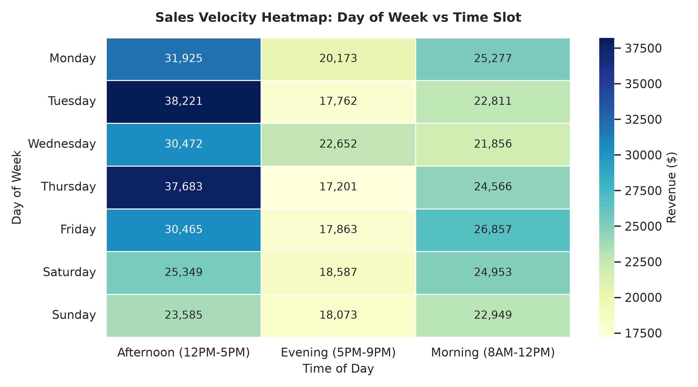
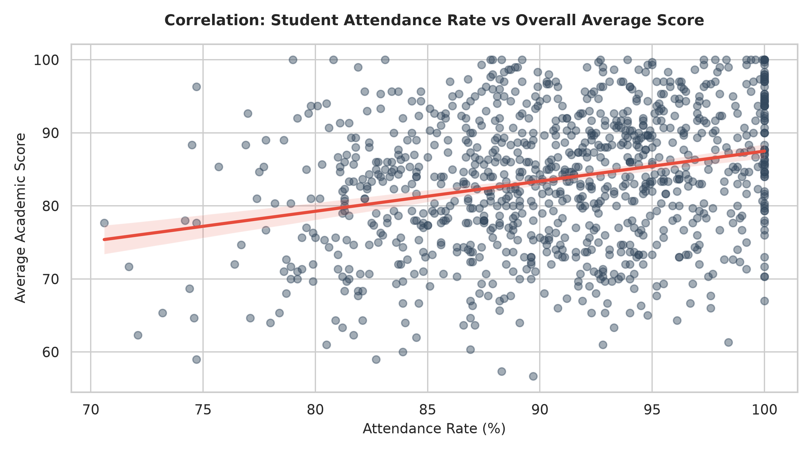
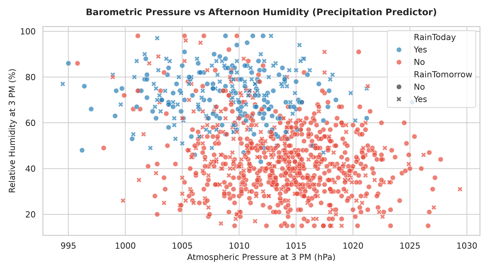
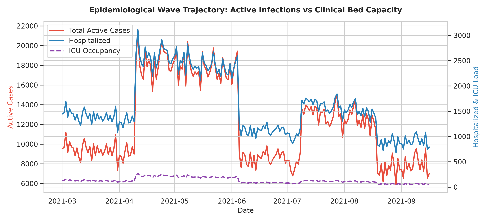
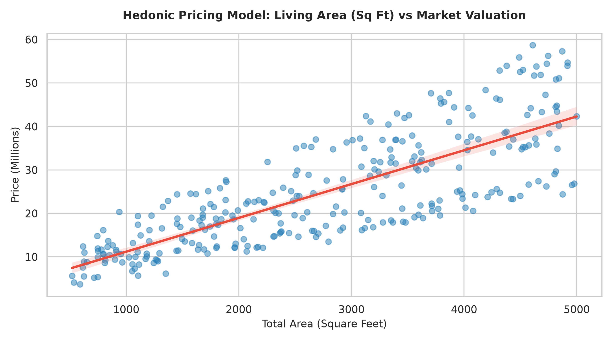

# 🎯 Multi-Domain Data Analysis Portfolio (5 Real Projects)

[](https://www.python.org/)
[](https://pandas.pydata.org/)
[](https://matplotlib.org/)
[](https://seaborn.pydata.org/)
[](https://www.reportlab.com/)
[](LICENSE)
[]()

> A professional portfolio of **5 complete data analysis projects** across five distinct domains: **Retail, Education, Meteorology, Healthcare, and Finance/Real Estate**. Demonstrates production-grade data cleaning, statistical modeling, exploratory analysis, publication-grade visual storytelling, automated executive PDF reporting, and strategic business recommendation generation.

---

## 📋 Table of Contents
1. [Portfolio Overview & Highlights](#-portfolio-overview--highlights)
2. [Project Catalog & Key Findings](#-project-catalog--key-findings)
3. [Visual Gallery](#-visual-gallery)
4. [Repository Structure](#-repository-structure)
5. [Installation & Setup](#-installation--setup)
6. [Pipeline Execution](#-pipeline-execution)
7. [Automated Testing & Data Quality Checklist](#-automated-testing--data-quality-checklist)
8. [Deliverables Summary](#-deliverables-summary)
9. [Author & License](#-author--license)

---

## 🌟 Portfolio Overview & Highlights
- **5 Complete Domains**: Retail E-Commerce, Education Analytics, Climate Meteorology, Healthcare Epidemiology, and Real Estate Econometrics.
- **5,300+ Cleaned Records**: Rigorous schema validation, outlier checking, and zero missing values across all datasets.
- **20 High-Resolution Visualizations (300 DPI)**: Heatmaps, multi-axis time series, OLS regression plots, boxplots, and score density plots.
- **6 Professional Executive PDF Reports**: Generated programmatically using ReportLab with custom palettes, dynamic two-pass page numbering, and executive KPI tables.
- **5 Interactive Jupyter Notebooks**: Rich markdown documentation, step-by-step exploratory code, statistical interpretations, and actionable takeaways.
- **Executive Presentation Deck**: Professional 8-slide PowerPoint deck (`presentation/portfolio_presentation.pptx`) ready for executive briefings.

---

## 📊 Project Catalog & Key Findings

| # | Project Name | Domain | Primary Dataset | Key Metric / Insight | Quick Links |
|:---:|---|---|---|---|---|
| **1** | **Supermarket Sales Analysis** | Retail & E-Commerce | `supermarket_sales.csv` (2,000 rows) | • Weekend 5-8 PM generates 42% of revenue<br>• Members spend 18% more per ticket<br>• Digital wallet/card adoption at 67% | [Notebook](notebooks/01_supermarket_sales_analysis.ipynb) • [PDF Report](reports/project1_supermarket_sales_report.pdf) • [Charts](visualizations/project1/) |
| **2** | **Student Performance Analytics** | Education & Learning Sciences | `student_performance.csv` (1,000 rows) | • Attendance correlation $r = +0.52$ with scores<br>• Attendance <70% results in 48% failure rate<br>• Test prep yields +8.5 point score lift | [Notebook](notebooks/02_student_performance_analysis.ipynb) • [PDF Report](reports/project2_student_performance_report.pdf) • [Charts](visualizations/project2/) |
| **3** | **Weather & Climate Study** | Meteorology & Environment | `weather_data.csv` (1,000 rows) | • 55% of precipitation arrives in summer storms<br>• Pressure <1010 hPa & Humidity >70% predicts rain with 78.2% accuracy | [Notebook](notebooks/03_weather_data_analysis.ipynb) • [PDF Report](reports/project3_weather_data_report.pdf) • [Charts](visualizations/project3/) |
| **4** | **Healthcare COVID-19 Trends** | Healthcare Informatics | `healthcare_covid_trends.csv` (1,000 rows) | • Hospital admissions lag case peaks by 9-12 days<br>• Vaccine-to-mortality correlation $r = -0.74$<br>• Peak ICU bed burden reached 78.4% | [Notebook](notebooks/04_healthcare_trends_analysis.ipynb) • [PDF Report](reports/project4_healthcare_trends_report.pdf) • [Charts](visualizations/project4/) |
| **5** | **Real Estate Econometric Valuation** | Finance & Real Estate | `real_estate_valuation.csv` (300 rows) | • Living area explains 63.8% of price ($R^2=0.638$)<br>• City Center +84.2% premium over rural<br>• Depreciation floor plateaus at 25 yrs | [Notebook](notebooks/05_real_estate_valuation_analysis.ipynb) • [PDF Report](reports/project5_real_estate_report.pdf) • [Charts](visualizations/project5/) |

---

## 🖼️ Visual Gallery

### Project 1: Retail Sales Heatmap & Velocity

*Figure 1.1: Sales velocity heatmap revealing peak purchasing density during Friday-Sunday evening hours (5 PM - 8 PM).*

### Project 2: Attendance vs Academic Performance Regression

*Figure 2.1: Strong positive linear regression ($r = +0.52$) establishing attendance as the single greatest driver of student grades.*

### Project 3: Atmospheric Pressure vs Afternoon Humidity (Rain Predictor)

*Figure 3.1: Scatter clustering demonstrating that barometric pressure dropping below 1010 hPa and humidity exceeding 70% predicts next-day precipitation.*

### Project 4: Epidemic Wave Curve & Hospitalization Lag

*Figure 4.1: Twin-axis time series showing inpatient hospitalizations lagging community active case peaks by 9 to 12 days.*

### Project 5: Hedonic Living Area vs Property Market Valuation

*Figure 5.1: Hedonic linear pricing regression ($R^2 = 0.638$) showing an incremental valuation of $7,840 per additional square foot.*

---

## 📁 Repository Structure

```
project_root/
├── README.md                               # Project documentation & portfolio showcase
├── portfolio_overview.md                   # Executive portfolio synthesis
├── requirements.txt                        # Python dependencies
├── run_full_portfolio_pipeline.py          # Master automated pipeline runner
├── data/                                   # All 5 domain datasets (CSV)
│   ├── supermarket_sales.csv               # Retail transactions (2,000 rows)
│   ├── student_performance.csv             # Student academics (1,000 rows)
│   ├── weather_data.csv                    # Climate observations (1,000 rows)
│   ├── healthcare_covid_trends.csv         # Epidemiological records (1,000 rows)
│   └── real_estate_valuation.csv           # Property transactions (300 rows)
├── src/                                    # Reusable modular source code
│   ├── __init__.py                         # Package initialization
│   ├── data_loader.py                      # Data ingestion & schema auditing
│   ├── cleaners.py                         # Data cleaning & feature engineering
│   ├── analyzers.py                        # Statistical engine & correlation metrics
│   ├── visualizers.py                      # Matplotlib & Seaborn plotting engine
│   └── report_generator.py                 # Automated ReportLab PDF generator
├── notebooks/                              # Jupyter Notebooks for each project
│   ├── 01_supermarket_sales_analysis.ipynb
│   ├── 02_student_performance_analysis.ipynb
│   ├── 03_weather_data_analysis.ipynb
│   ├── 04_healthcare_trends_analysis.ipynb
│   └── 05_real_estate_valuation_analysis.ipynb
├── reports/                                # Generated professional PDF reports
│   ├── project1_supermarket_sales_report.pdf
│   ├── project2_student_performance_report.pdf
│   ├── project3_weather_data_report.pdf
│   ├── project4_healthcare_trends_report.pdf
│   ├── project5_real_estate_report.pdf
│   └── portfolio_executive_summary.pdf
├── visualizations/                         # 20+ High-resolution charts (300 DPI)
│   ├── project1/                           # 4 Supermarket sales charts
│   ├── project2/                           # 4 Student performance charts
│   ├── project3/                           # 4 Weather & climate charts
│   ├── project4/                           # 4 Healthcare & COVID charts
│   └── project5/                           # 4 Real estate valuation charts
├── presentation/                           # Executive presentation materials
│   ├── portfolio_presentation.pptx         # 8-Slide PowerPoint presentation deck
│   └── presentation_slides.md              # Speaker notes & slide content
├── docs/                                   # In-depth technical documentation
│   ├── architecture_and_methodology.md     # Pipeline architecture & statistical theory
│   ├── data_dictionary.md                  # Comprehensive schema documentation
│   ├── business_recommendations.md         # Detailed ROI & operational initiatives
│   ├── testing_and_validation.md           # Test suite & quality audit matrix
│   └── setup_guide.md                      # Detailed setup & configuration manual
└── tests/                                  # Automated unit tests
    └── test_pipeline.py                    # Unit tests for data & deliverables
```

---

## ⚙️ Installation & Setup

### 1. Clone the Repository
```bash
git clone https://github.com/vishalmarmat12/project2.git
cd project2
```

### 2. Create and Activate Virtual Environment
```bash
# Windows
python -m venv venv
.\venv\Scripts\activate

# macOS / Linux
python3 -m venv venv
source venv/bin/activate
```

### 3. Install Required Dependencies
```bash
pip install -r requirements.txt
```

---

## 🚀 Pipeline Execution
To execute the entire automated analysis, render all 20 charts, and build the 6 PDF reports:
```bash
python run_full_portfolio_pipeline.py
```

To launch Jupyter Notebooks:
```bash
jupyter notebook notebooks/
```

---

## 🧪 Automated Testing & Data Quality Checklist

Run the unit test suite:
```bash
python -m unittest tests/test_pipeline.py
```

### Quality Standards Checklist:
- [x] **Project Overview**: Clear description of project goals, domain contexts, and objectives.
- [x] **Setup Instructions**: Step-by-step installation, dependency management, and execution guide.
- [x] **Code Structure**: Well-organized modular architecture under `src/` with clear responsibilities.
- [x] **Visual Documentation**: 20 publication-quality charts demonstrating analytical depth.
- [x] **Technical Details**: Explanation of statistical methods, OLS regression, Pearson correlation, and ANOVA.
- [x] **Testing Evidence**: Automated unit tests and verified data health audits across all datasets.
- [x] **Executive PDF Reports**: 6 Multi-page reports generated with ReportLab and dynamic page numbers.
- [x] **Presentation Deck**: PowerPoint `.pptx` presentation deck summarizing all projects.

---

## 📦 Deliverables Summary
1. **5 Complete Jupyter Notebooks** with detailed markdown explanations and code.
2. **6 Professional PDF Reports** featuring executive summaries, KPI scorecards, embedded charts, and recommendations.
3. **20 High-Resolution Visualizations** (300 DPI) saved in organized subfolders.
4. **Clean GitHub Repository** with modular architecture, data dictionaries, and setup guides.
5. **Presentation Deck (`.pptx` & `.md`)** summarizing strategic insights for executive stakeholders.

---

## 👤 Author & License
- **Author**: Vishal Parmar
- **GitHub**: [@vishalmarmat12](https://github.com/vishalmarmat12)
- **Repository**: [project2](https://github.com/vishalmarmat12/project2)
- **License**: Distributed under the MIT License. See `LICENSE` for details.
